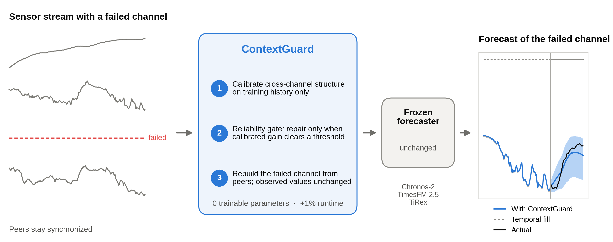

# ContextGuard

**Reliability-gated repair for frozen time-series foundation models under sensor dropout**

[](https://doi.org/10.5281/zenodo.22124598)
[](LICENSE)


When a sensor fails, the channel disappears from the entire forecasting context and temporal
interpolation has nothing to anchor on. ContextGuard recovers the failed channel from its synchronized
peers *before* an unchanged probabilistic forecaster is called. It estimates regularized cross-channel
structure on an early training segment, calibrates a bounded per-channel weight on a later segment, and
activates recovery only when the calibrated improvement over the pooled-mean fallback clears a fixed
threshold. Observed coordinates and clean contexts are returned unchanged by construction, the wrapper
has no trainable parameters, and it works in front of any forecaster.



## Results at a glance

| Evaluation | Cells | MSE | MAE | Quantile loss |
|---|---:|---:|---:|---:|
| 8 GIFT-Eval configurations, Chronos-2 and TimesFM 2.5, vs topology-aware repair | 160 | **−37.89%** | **−31.07%** | **−40.01%** |
| Same cells, vs the trained HELIX imputer | 160 | −19.12% | −12.25% | −15.03% |
| 6 held-out hourly configurations, three forecasters, vs topology | 180 | −27.86% | −23.31% | −31.69% |
| TiRex (third forecaster) on the 8 primary configurations, vs topology | 80 | −35.15% | −30.26% | −36.66% |

Geometric mean changes over paired cells; every dataset-cluster bootstrap interval lies below zero.

* **The gate is estimator-agnostic.** It improves ridge-regression (−2.02% MSE), Ledoit–Wolf (−2.27%)
  and ContextGuard's pooled conditional estimate (−2.30%), and reduces the cells in which repair is worse
  than temporal filling; gated ContextGuard is the most accurate configuration.
* **The gate transfers out of sample.** A cross-fitted gate reproduces 49 of 50 activation decisions,
  and on test contexts gated reconstruction beats the fallback on 44 of 45 active channels (geometric
  error ratio 0.108).
* **The gain is predictable before deployment.** The recovered fraction of dropout-induced loss follows
  the reconstruction accuracy of the failed channel (Spearman ρ = 0.96) and is predicted by the
  training-only calibration improvement (ρ = 0.95 across dataset–forecaster pairs).
* **Native missing-value inputs are no substitute.** Passing the failed channel as missing values
  yields degenerate intervals (Chronos-2), no recovery (TiRex) or an error (TimesFM 2.5).
* **Cost.** +1.08% median end-to-end time, no change in peak memory, zero trainable parameters.

## Installation

```bash
git clone https://github.com/XingjianZhang-dev/contextguard.git
cd contextguard
pip install -e .            # NumPy and SciPy only
pip install -e ".[analysis,test]"   # to regenerate the paper's tables and figures and run the tests
```

## Usage

```python
import numpy as np
from contextguard import ContextGuard

# train: (time, channels) training history, NaN where values are missing; or a list of such arrays
guard = ContextGuard().fit(train)
print(guard.gate_["g"])                 # per-channel gate: 0 means the channel is never reconstructed

context = latest_window.copy()          # (length, channels) or (batch, length, channels)
context[:, failed_channel] = np.nan     # a dead sensor
repaired = guard.repair(context)        # observed values are returned bit for bit
forecast = model.predict(repaired)      # any frozen forecaster, unchanged
```

`guard.repair(context, method="topology")` gives the temporal baseline, and the classical estimators of
the paper are available in `contextguard.estimators` (ridge regression, Ledoit–Wolf, cross-fitted gate).

## Repository layout

```
src/contextguard/        the method: training statistics and gate, repair, estimators, paired statistics
experiments/
  evaluate.py            revision evaluator (estimators, cross-fitted gate, TiRex, native missing input)
  run_revision.sh        the four revision experiment sets
  setup_env.sh           pinned forecasting environments
  download_assets.py     pinned GIFT-Eval data and checkpoints, verified by hash
  configs/               configurations, dataset fingerprints and model hashes
  original/              evaluator, matrix runner, HELIX training and audit programs of the original study
analysis/                every number, table and figure of the paper from the run records
results/
  cells/                 per-run metrics of all 3,184 revision runs
  summaries/             statistical summaries (JSON/CSV)
  tables/                LaTeX tables
  figures/               Figures 1-5 and the graphical abstract
tests/                   unit, reference-equivalence, regression and record-consistency tests
scripts/fetch_records.sh downloads and verifies the run records from Zenodo
docs/                    reproduction guide and record format
```

## Reproducing the paper

Three levels, from seconds to a full rerun (details in [docs/reproducing.md](docs/reproducing.md)).

1. **Tables and figures from the released summaries** (seconds):
   `make tables figures`
2. **All summaries from the run records** (about 10 minutes on a laptop, no GPU):
   `make records summaries tables figures test`
   The records (manifests and window-level arrays of 3,184 revision runs and 1,760 original-study runs)
   are archived on Zenodo and verified by checksum.
3. **Full rerun on a GPU**: `experiments/setup_env.sh`, `python experiments/download_assets.py`, then
   `experiments/run_revision.sh all`; the original study is rerun with
   `experiments/original/scripts/run_gift_matrix.py` and the configurations in `experiments/original/configs`.
   Every run records its dataset fingerprint and model hash, which must equal the values in
   `experiments/configs/assets.json`.

The revision evaluator calls the original evaluator for data handling, corruption and repair, so the
topology and ContextGuard runs of the revision reproduce the original records (all 320 primary runs
agree to within 10⁻⁴ relative difference on a different GPU architecture).

## Data and models

Datasets are the official GIFT-Eval configurations (`Salesforce/GiftEval`, revision `30841734`).
Forecasters: Chronos-2 (`amazon/chronos-2`), TimesFM 2.5 (`google/timesfm-2.5-200m-pytorch`) and TiRex
(`NX-AI/TiRex`), each at a pinned revision. Data and weights are not redistributed; they are downloaded
from their sources under their original licenses and checked against the recorded hashes.

## Citation

```bibtex
@software{zhang2026contextguard,
  author    = {Zhang, Xingjian},
  title     = {{ContextGuard}: Reliability-gated repair for frozen time-series foundation models under sensor dropout},
  year      = {2026},
  version   = {3.0.0},
  publisher = {Zenodo},
  doi       = {10.5281/zenodo.22124598},
  url       = {https://github.com/XingjianZhang-dev/contextguard}
}
```

## License

MIT, see [LICENSE](LICENSE).
